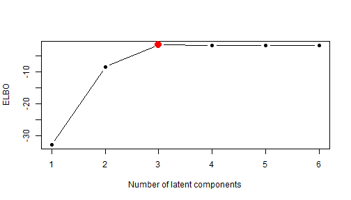
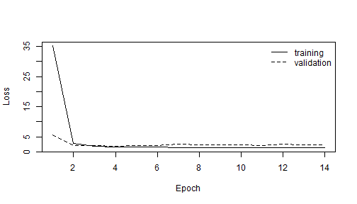
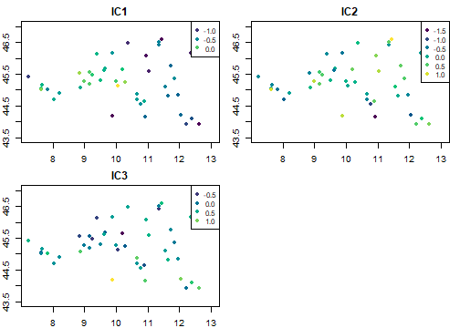
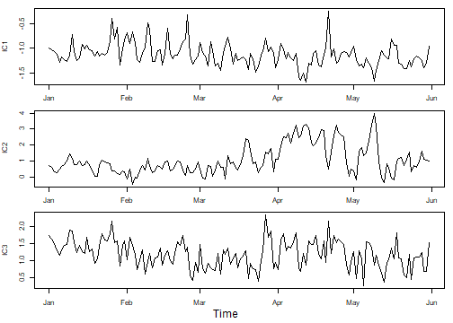
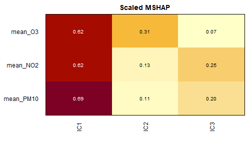

<!-- This vignette is precomputed because fitting the models needs
TensorFlow. Edit NonlinearBSS.Rmd.orig and run vignettes/precompile.R. -->


In nonlinear blind source separation the observed $p$-variate data $x$ are
assumed to be generated as $x = f(z)$, where $f$ is an unknown injective
function and $z$ are independent latent components. The aim is to recover $z$
from $x$. Without further assumptions this is impossible, but nonstationarity
of the components over time or space, or temporal dependence, makes them
identifiable.

The package contains four methods:

* `TCL()`: time contrastive learning for time series,
* `VAE()`: a variational autoencoder for i.i.d. data (a baseline; not
  identifiable),
* `iVAE()`: the identifiable variational autoencoder for any data with
  auxiliary variables,
* `iVAEar()`: iVAE with nonstationary autoregressive latent components.

The models are fitted with TensorFlow through **keras3**. Install it once
with `keras3::install_keras()` and check the setup with `tf_available()`.

## Simulated data

`simulate_sources()` creates components whose means and variances change
over segments and `mix_data()` mixes them with a random neural network.


``` r
set.seed(1)
src <- simulate_sources(3, time = 1:3000, n_segments_time = 30)
x <- mix_data(src$sources, n_layers = 3)
```

## Auxiliary data

For iVAE the auxiliary variables $u$ should explain how the distribution of
the components changes. For a time series, indicators of time segments are a
simple choice:


``` r
A <- aux_matrix(aux_segments(100), x, time = 1:3000)
dim(A)
#> [1] 3000   30
```

Radial basis functions give a smooth alternative and are the default for data
with coordinates or time points:


``` r
A <- aux_matrix(aux_rbf(temporal_basis = c(9, 17, 37)), x, time = 1:3000)
dim(A)
#> [1] 3000   63
```

## Fitting iVAE


``` r
fit <- iVAE(x, aux_rbf(c(9, 17, 37)), time = 1:3000, epochs = 50,
            verbose = 0, seed = 1)
fit
#> Identifiable variational autoencoder (iVAE)
#> 
#> Call: iVAE(x = x, aux = aux_segments(100), time = 1:3000, epochs = 50, 
#>     seed = 1, verbose = 0)
#> Data: x (3000 observations, 3 variables, format matrix)
#> Latent components: 3
#> Auxiliary data: segmentation, size = 100, joint = 1 [30 variables]
#> Distributions: source gaussian, error gaussian (sigma 0.02)
#> ELBO: -3.377
absolute_mean_correlation(fit$S, src$sources)
#> [1] 0.8743261
```

The mean correlation coefficient compares the estimates with the true
components up to permutation and sign; 1 means perfect recovery. The
components are stored as `fit$S` and are returned in the format of the data
by `components()`.

## Choosing the number of latent components

In practice the number of latent components is unknown. Following Sipilä
et al. (2025, *Neural Networks*; 2026, *Spatial Statistics*), it can be
selected by fitting models with different numbers of components $L$ and
maximising the profile AIC
$$\mathrm{pAIC} = \mathrm{ELBO} - L,$$
where the ELBO is the average evidence lower bound per observation. Here
the three sources are mixed into six observed variables, and models with one
to six components are compared:


``` r
x6 <- mix_data(src$sources, n_layers = 3, output_dim = 6)
sel <- select_latent_dim(x6, latent_dims = 1:6, aux = aux_segments(100),
                         time = 1:3000, epochs = 50, verbose = 0, seed = 1)
sel
#> Selection of the number of latent components
#> 
#>  latent_dim    elbo    pAIC selected
#>           1 -32.837 -33.837         
#>           2  -8.422 -10.422         
#>           3  -1.496  -4.496        *
#>           4  -1.679  -5.679         
#>           5  -1.553  -6.553         
#>           6  -1.624  -7.624         
#> 
#> Selected by the largest pAIC = ELBO - number of components: 3
```

The ELBO increases steeply until the true number of components and stays
nearly constant after that:


``` r
plot(sel)
```



The selected model is kept in the result. Models that were fitted
separately, for example in different sessions, can be compared with
`latent_dim_selection(list(fit1, fit2, ...))`. The models should differ only
in the number of components, since the ELBO also depends on the data, the
auxiliary variables and `error_dist_sigma`.

## Time series formats

Time series objects (`ts`, `xts`, `zoo`, `tsibble`) can be used directly, and
the results are returned in the same format.


``` r
xt <- ts(x, start = c(2000, 1), frequency = 12)
tcl <- TCL(xt, n_segments = 30, epochs = 50, verbose = 0, seed = 1)
class(components(tcl))
#> [1] "mts"    "ts"     "matrix" "array"
absolute_mean_correlation(tcl$S, src$sources)
#> [1] 0.7072431
```

## Spatio-temporal data

The data set `pollution_northern_italy` contains daily air quality
measurements at 50 stations. We use January to May 2020 for training and
June 2020 for validation, and keep five stations aside to test spatial
interpolation. The data frame is used with the column names of the
coordinates, time points and variables.


``` r
P <- subset(pollution_northern_italy, time < as.Date("2020-07-01"))
stations <- unique(P$AirQualityStation)
set.seed(2)
test_stations <- sample(stations, 5)
P_obs <- subset(P, !AirQualityStation %in% test_stations)
train <- subset(P_obs, time < as.Date("2020-06-01"))
valid <- subset(P_obs, time >= as.Date("2020-06-01"))
vars <- c("mean_O3", "mean_NO2", "mean_PM10")
```

`iVAEar()` models the components as nonstationary autoregressive processes.
The training is monitored on the validation period and stopped when the
validation loss no longer improves.


``` r
fit <- iVAEar(train, aux = aux_rbf(spatial_basis = c(2, 5),
                                   temporal_basis = c(5, 9, 17)),
              coords = c("Longitude", "Latitude"), time = "time", vars = vars,
              validation_data = valid, epochs = 100, verbose = 0, seed = 1,
              callbacks = list(keras3::callback_early_stopping(
                patience = 10, restore_best_weights = TRUE)))
summary(fit)
#> Identifiable variational autoencoder with autoregressive components (iVAEar)
#> 
#> Call: iVAEar(x = train, aux = aux_rbf(spatial_basis = c(2, 5), temporal_basis = c(5, 
#>     9, 17)), coords = c("Longitude", "Latitude"), time = "time", 
#>     vars = vars, epochs = 100, validation_data = valid, callbacks = list(keras3::callback_early_stopping(patience = 10, 
#>         restore_best_weights = TRUE)), seed = 1, verbose = 0)
#> 
#> Data: train 
#>   observations: 6840 
#>   variables: 3 
#>   format: data.frame 
#> Latent components: 3 
#> Autoregressive order: 1 
#> Auxiliary data: radial basis functions, spatial = 2, 5, temporal = 5, 9, 17 (gaussian) [60 variables]
#> 
#> Network: hidden units 128-128-128, auxiliary function 128-128-128, activation leaky_relu
#> Distributions: source gaussian, error gaussian
#> 
#> Training: 14 epochs, final loss 1.38, validation loss 2.3
#> ELBO: -1.3575 
#> Largest absolute correlation between components: 0.416 
#> 
#> Prior variance of the standardised components over the data:
#>         0%   50%  100%
#> IC1 0.0369 0.137 0.436
#> IC2 0.1157 0.255 0.769
#> IC3 0.1899 0.346 1.798
#> 
#> Autoregressive coefficients over the data:
#>  component lag   min  mean   max
#>        IC1   1 0.323 0.825 0.969
#>        IC2   1 0.278 0.717 0.866
#>        IC3   1 0.341 0.635 0.901
```


``` r
plot(fit, type = "history")
```



The components can be shown as maps at a given day, or as time series at a
station:


``` r
plot(fit, time = as.Date("2020-04-01"))
```




``` r
plot(fit, type = "series", series = 1)
```



## Forecasting and interpolation

The trend, variance and autoregressive coefficient functions can be
evaluated anywhere, and the components can be forecast from their last
values by iterating the autoregressive prior. With `space = "data"` the
predicted components are decoded to the observed variables. Here we
forecast the first week of June, one to seven days after the end of the
training data:


``` r
first_week <- subset(valid, time < as.Date("2020-06-08"))
fc <- predict(fit, first_week, type = "forecast",
              coords = c("Longitude", "Latitude"), time = "time",
              space = "data")
head(fc)
#>       Longitude Latitude       time  mean_O3  mean_NO2 mean_PM10
#> 62964  11.43317 46.58967 2020-06-01 86.05085  5.336327  19.96109
#> 62965  11.43317 46.58967 2020-06-02 82.13615  7.210164  18.25286
#> 62966  11.43317 46.58967 2020-06-03 78.74678  8.549547  17.21989
#> 62967  11.43317 46.58967 2020-06-04 75.76857  9.616633  16.63974
#> 62968  11.43317 46.58967 2020-06-05 73.19196 10.475907  16.41044
#> 62969  11.43317 46.58967 2020-06-06 70.78212 11.234819  16.50159
```

The mean absolute error of the ozone forecasts by forecast day, compared
with the standard deviation of ozone in June:


``` r
err <- abs(fc$mean_O3 - first_week$mean_O3)
round(tapply(err, first_week$time, mean), 1)
#> 2020-06-01 2020-06-02 2020-06-03 2020-06-04 2020-06-05 2020-06-06 2020-06-07 
#>        6.2       13.2       11.3       13.4       11.2       12.8        8.7
round(sd(valid$mean_O3), 1)
#> [1] 19
```

Spatial interpolation uses the trend function at the locations of the five
stations not used in fitting:


``` r
test <- subset(P, AirQualityStation %in% test_stations &
                 time < as.Date("2020-06-01"))
interp <- predict(fit, test, type = "trend",
                  coords = c("Longitude", "Latitude"), time = "time",
                  space = "data")
round(c(MAE = mean(abs(interp$mean_O3 - test$mean_O3)),
        sd = sd(test$mean_O3)), 1)
#>  MAE   sd 
#> 19.9 31.9
```

## Interpretation

`mshap()` measures how much each latent component contributes to each
observed variable by mean absolute kernel SHAP values of the decoder. The
scaled values sum to one for each variable. Sipilä et al. (2026, *Spatial
Statistics*) used them to interpret the latent components of weather and air
pollution data over Northern Italy.


``` r
ms <- mshap(fit, n_sample = 500, n_background = 50, seed = 1)
ms
#> Scaled mean absolute SHAP values (rows: variables, columns: components)
#> 
#>             IC1   IC2   IC3
#> mean_O3   0.618 0.307 0.075
#> mean_NO2  0.619 0.133 0.248
#> mean_PM10 0.690 0.105 0.204
#> Average   0.642 0.182 0.176
#> 
#> Based on 500 observations and 50 background observations.
```


``` r
plot(ms)
```



## Spatial data formats

With an `sf` or `sftime` object the coordinates and time points are taken
from the object, and the results are again `sf` objects.


``` r
s <- sf::st_as_sf(train, coords = c("Longitude", "Latitude"), crs = 4326)
fit_sf <- iVAE(s, aux_rbf(c(2, 5), c(5, 9)), time = "time", vars = vars,
               epochs = 10, verbose = 0, seed = 1)
head(components(fit_sf), 3)
#> Simple feature collection with 3 features and 4 fields
#> Geometry type: POINT
#> Dimension:     XY
#> Bounding box:  xmin: 11.43317 ymin: 46.58967 xmax: 11.43317 ymax: 46.58967
#> Geodetic CRS:  WGS 84
#>         time       IC1       IC2        IC3                  geometry
#> 1 2020-01-01 -1.568821 -1.209133 -0.7660792 POINT (11.43317 46.58967)
#> 2 2020-01-02 -1.475576 -1.162208 -0.8238250 POINT (11.43317 46.58967)
#> 3 2020-01-03 -1.285793 -1.195195 -0.9457133 POINT (11.43317 46.58967)
```

## Large data

For large spatio-temporal data the auxiliary matrix can become very large.
With `batch_aux = TRUE` the auxiliary variables are computed for each batch
inside the network from the coordinates and time points, which gives the
same model with much less memory:


``` r
fit <- iVAEar(pollution_northern_italy, aux_rbf(),
              coords = c("Longitude", "Latitude"), time = "time", vars = vars,
              batch_aux = TRUE)
```

## Saving models

The trained weights are stored in the fitted object, so models can be saved
with `save_nlbss()` (or `saveRDS()`) and used in a new session:


``` r
file <- tempfile(fileext = ".rds")
save_nlbss(fit, file)
fit2 <- load_nlbss(file)
all.equal(predict(fit2, type = "trend"), predict(fit, type = "trend"))
#> [1] TRUE
```

## Migrating from version 0.1.0

The specialised functions of version 0.1.0, such as `iVAEar_radial()` and
`predict_coords_to_IC_ar()`, are replaced by the interface described here.
The `NEWS.md` file of the package has a table of the old and new calls.

## References

* Hyvärinen, A. and Morioka, H. (2016). Unsupervised feature extraction by
  time-contrastive learning and nonlinear ICA. *Advances in Neural
  Information Processing Systems*, 29.
* Khemakhem, I., Kingma, D., Monti, R. and Hyvärinen, A. (2020). Variational
  autoencoders and nonlinear ICA: A unifying framework. *AISTATS 2020*,
  2207–2217.
* Sipilä, M., Nordhausen, K. and Taskinen, S. (2024). Nonlinear blind source
  separation exploiting spatial nonstationarity. *Information Sciences*, 665,
  120365. <https://doi.org/10.1016/j.ins.2024.120365>
* Sipilä, M., Cappello, C., De Iaco, S., Nordhausen, K. and Taskinen, S.
  (2025). Modelling multivariate spatio-temporal data with identifiable
  variational autoencoders. *Neural Networks*, 181, 106774.
  <https://doi.org/10.1016/j.neunet.2024.106774>
* Sipilä, M., Nordhausen, K. and Taskinen, S. (2025). Identifiable
  autoregressive variational autoencoders for nonlinear and nonstationary
  spatio-temporal blind source separation. *ECML PKDD 2025*, Lecture Notes in
  Computer Science 16019, 362–380.
  <https://doi.org/10.1007/978-3-032-06109-6_21>
* Sipilä, M., De Iaco, S., Cappello, C., Nordhausen, K., Palma, M. and
  Taskinen, S. (2026). Enhancing identifiable variational autoencoder in the
  presence of missing values and auxiliary covariates for spatio-temporal
  ozone modeling. *Environmetrics*, 37(6), e70121.
  <https://doi.org/10.1002/env.70121>
* Sipilä, M., Cappello, C., De Iaco, S., Nordhausen, K., Palma, M. and
  Taskinen, S. (2026). Identifiable variational autoencoders for
  interpretable dimension reduction and prediction in multivariate
  spatio-temporal processes. *Spatial Statistics*, 101054.
  <https://doi.org/10.1016/j.spasta.2026.101054>
